# University Network Infrastructure | Cisco Packet Tracer

## Overview

This project presents the design and simulation of the network infrastructure of a university building using Cisco Packet Tracer. The simulation is based on the main building of the Computer Science faculty at the Universidad Politécnica de Sinaloa (UPSIN), a three-level academic building with administrative offices, computer laboratories, wireless users, IoT devices, IP telephones, and centralized network services.

The project focuses on organizing the network through VLAN segmentation, IPv4 addressing with VLSM, inter-VLAN routing, and the configuration and validation of common network services.

## Project Objectives

- Design a structured network for a multi-floor university building.
- Separate departments and services through VLANs.
- Apply IPv4 subnetting based on host requirements.
- Enable communication between VLANs through a central router.
- Configure and validate centralized network services.
- Integrate VoIP telephony and IoT devices into the simulated infrastructure.

## Building Structure

The building is divided into three levels. Floor names follow the Mexican convention used in the screenshots:

| Level        | Name in the project | Main areas                          |
|--------------|---------------------|-------------------------------------|
| Ground floor | Planta Baja         | Offices, lobby                      |
| First floor  | Primer Piso         | Offices, 3 computer laboratories    |
| Second floor | Segundo Piso        | Offices, 5 computer laboratories    |

## Network Architecture

The network uses a hierarchical star topology. A central core switch (Switch-CORE) connects to the access switches distributed throughout the building, while trunk links carry the traffic of multiple VLANs between them. Access switches provide connectivity to the end devices of their corresponding floor or laboratory.

A central Cisco 2811 router handles inter-VLAN routing using a Router-on-a-Stick configuration and also connects the server network (site), where all centralized services are hosted:

- **FastEthernet0/1:** 802.1Q trunk toward the core switch, with one subinterface per VLAN.
- **FastEthernet0/0:** connection to the server network (172.16.50.1).

## Network Design and Technologies

### VLANs and IP Addressing

VLANs were configured to logically separate network areas and services, organizing traffic by department, floor, and service. The network uses private IPv4 addressing based on the 172.16.0.0 address space, and subnets were assigned with VLSM to accommodate different host requirements: larger segments use /24 subnets, while laboratory segments use /26 subnets.

To make the design easier to read, the VLAN number matches the router subinterface number, and in most networks it also matches the third octet of the address (for example, VLAN 80 uses 172.16.80.0/24). Since several laboratories share the same third octet, each one has its own VLAN and /26 subnet.

The DHCP server has one address pool per VLAN. In every pool, the first addresses are reserved for the default gateway and static devices, and dynamic assignment starts at the tenth host of each subnet (for example, 172.16.20.10 in 172.16.20.0/26 and 172.16.20.74 in 172.16.20.64/26). All pools deliver the DNS server 172.16.50.11, and the VOIP pool also delivers the TFTP server 172.16.80.1 (the router running CME) so the IP phones can download their configuration.

| VLAN | Area                                 | Router subinterface | Network          | Default gateway | DHCP pool   | First DHCP address | Max users |
|------|--------------------------------------|---------------------|------------------|-----------------|-------------|--------------------|-----------|
| 10   | Ground floor offices                 | Fa0/1.10            | 172.16.10.0/24   | 172.16.10.1     | OFICINAS_PB | 172.16.10.10       | 200       |
| 11   | First floor offices                  | Fa0/1.11            | 172.16.11.0/24   | 172.16.11.1     | OFICINAS_P1 | 172.16.11.10       | 200       |
| 12   | Second floor offices                 | Fa0/1.12            | 172.16.12.0/24   | 172.16.12.1     | OFICINAS_P2 | 172.16.12.10       | 200       |
| 20   | First floor laboratory 1             | Fa0/1.20            | 172.16.20.0/26   | 172.16.20.1     | P2-LAB1     | 172.16.20.10       | 50        |
| 21   | First floor laboratory 2             | Fa0/1.21            | 172.16.20.64/26  | 172.16.20.65    | P2-LAB2     | 172.16.20.74       | 50        |
| 22   | First floor laboratory 3             | Fa0/1.22            | 172.16.20.128/26 | 172.16.20.129   | P2-LAB3     | 172.16.20.138      | 50        |
| 30   | Second floor laboratory 1            | Fa0/1.30            | 172.16.30.0/26   | 172.16.30.1     | P3-LAB1     | 172.16.30.10       | 50        |
| 31   | Second floor laboratory 2            | Fa0/1.31            | 172.16.30.64/26  | 172.16.30.65    | P3-LAB2     | 172.16.30.74       | 50        |
| 32   | Second floor laboratory 3            | Fa0/1.32            | 172.16.30.128/26 | 172.16.30.129   | P3-LAB3     | 172.16.30.138      | 50        |
| 33   | Second floor laboratory 4            | Fa0/1.33            | 172.16.30.192/26 | 172.16.30.193   | P3-LAB4     | 172.16.30.202      | 50        |
| 34   | Second floor laboratory 5            | Fa0/1.34            | 172.16.31.0/26   | 172.16.31.1     | P3-LAB5     | 172.16.31.10       | 50        |
| 40   | General building Wi-Fi               | Fa0/1.40            | 172.16.40.0/24   | 172.16.40.1     | WI-FI       | 172.16.40.10       | 200       |
| 70   | IoT devices                          | Fa0/1.70            | 172.16.70.0/24   | 172.16.70.1     | IOT         | 172.16.70.10       | 200       |
| 80   | VoIP telephony                       | Fa0/1.80            | 172.16.80.0/24   | 172.16.80.1     | VOIP        | 172.16.80.10       | 200       |
| —    | Server network (site)                | Fa0/0               | 172.16.50.0/24   | 172.16.50.1     | Static      | —                  | —         |

Each VLAN has its own IP subnet and broadcast domain. In the DHCP pool names, laboratories are numbered by building level (`P2` = first floor, `P3` = second floor), while offices use `PB`, `P1`, and `P2` for the ground, first, and second floors.

### Server Network (Site)

All centralized servers are located in the site area and connected to the router interface FastEthernet0/0 (172.16.50.1) through a dedicated switch (Switch-SITE). The servers use static IPv4 addresses within the 172.16.50.0/24 network.

Static addressing was chosen so that the servers never depend on another service such as DHCP to obtain their address. This guarantees that their addresses never change or get lost, so every client can always reach the DHCP, DNS, web, and email services at the same address. For example, the DNS server (172.16.50.11) is the address delivered to all clients through DHCP.

The site includes the following servers:

- DHCP server
- DNS / HTTP server
- Web server
- Email server
- IoT server

The `serverPool` that appears in the DHCP service is the default pool that Packet Tracer creates on every server. It is not used, since all servers have static addresses.

### Inter-VLAN Routing

Router-on-a-Stick was implemented to enable communication between VLANs. The router interface FastEthernet0/1 is configured as an 802.1Q trunk with 14 subinterfaces, one per VLAN (Fa0/1.10 to Fa0/1.80), each one acting as the default gateway of its network. Trunk links between the core and access switches transport the VLAN traffic.

### Network Services

Centralized services were configured and tested:

- **DHCP:** Provides dynamic IPv4 address assignment to client devices, including the default gateway and DNS server of each VLAN.
- **DNS:** Resolves the configured university domain name, `upsin.edu.mx`.
- **HTTP:** Hosts a university-style website accessible by IP address and by domain name.
- **Email:** Configured mail service with user accounts in the `upsin.edu.mx` domain and successful email exchange between clients using SMTP and POP3.

### Wireless Network

Access points distributed across the three floors provide wireless connectivity to users through the general building Wi-Fi VLAN (VLAN 40).

### VoIP Telephony

The network includes Cisco IP Phone 7960 devices on a dedicated voice VLAN (VLAN 80). The router was configured with Cisco Call Manager Express (CME), phone extensions, and TFTP support. The phones obtain their IP address from the VOIP DHCP pool (172.16.80.0/24), which also points them to the router (172.16.80.1) as their TFTP server, so they can register and receive their configuration.

The IP phones registered successfully and a test call was completed between two different floors: extension 1016 (IP Phone-B-105, ground floor) called extension 1003 (IP Phone-B-303, second floor), and both phones showed the call as connected.

### IoT Integration

An IoT segment was created using VLAN 70. Wireless IoT devices connect through a WRT300N wireless router and are registered on the IoT server, where they are monitored and controlled from a dedicated client (PC-IOT) through the IoT Monitor service.

A total of 26 IoT devices were registered:

| Device type                  | Quantity | Function                                   |
|------------------------------|----------|--------------------------------------------|
| Webcam                       | 18       | Video surveillance throughout the building |
| RFID reader                  | 1        | Card-based access control                  |
| Door                         | 1        | Access door controlled by the RFID reader  |
| Air conditioner              | 2        | Climate control                            |
| Fire sprinkler               | 2        | Fire suppression                           |
| Fire sensor (Fire Monitor)   | 1        | Fire detection                             |
| Water drain                  | 1        | Water drainage for the sprinkler system    |

The door and the RFID reader are connected through an MCU board, which links both devices to the access control system.

#### Automation Rules

Automation rules were configured on the IoT server (IoT Monitor → Conditions):

| Rule      | Condition                                  | Actions                                                    |
|-----------|--------------------------------------------|------------------------------------------------------------|
| Abrir     | ID card ID = 1001                          | Unlock the door and set the RFID reader status to valid    |
| FireOn    | Fire detected by the Fire Monitor          | Turn on both fire sprinklers and the water drain           |
| FireOff   | No fire detected by the Fire Monitor       | Turn off both fire sprinklers                              |
| DrainOff  | Both fire sprinklers are off               | Turn off the water drain                                   |

These rules implement two systems: an access control system based on RFID cards and an automatic fire suppression system.

## Network Validation

The following functionality was configured and tested in the simulation:

| Test                  | Details                                                                                                      | Result     |
|-----------------------|--------------------------------------------------------------------------------------------------------------|------------|
| DHCP                  | PC11-B-202 (VLAN 20) obtained 172.16.20.13 /26, gateway 172.16.20.1 and DNS server 172.16.50.11               | Successful |
| Inter-VLAN routing    | PC2-B-309 (172.16.30.206, VLAN 33) pinged hosts in VLAN 11 and VLAN 20 with 0% packet loss and TTL=127, confirming the traffic was routed | Successful |
| DNS and HTTP          | PC-B-203 opened the university website using the domain name `upsin.edu.mx`                                  | Successful |
| Email                 | `profesor2@upsin.edu.mx` sent an email to `alumno1@upsin.edu.mx` and received a reply (PC-B-206 and PC-B-207)  | Successful |
| VoIP                  | Call between extension 1016 (ground floor) and extension 1003 (second floor)                                 | Successful |
| IoT                   | Devices registered on the IoT server and automation rules active in IoT Monitor                              | Successful |

## Screenshots

### Building overview

The three floors of the simulated building over a photo of the real building.

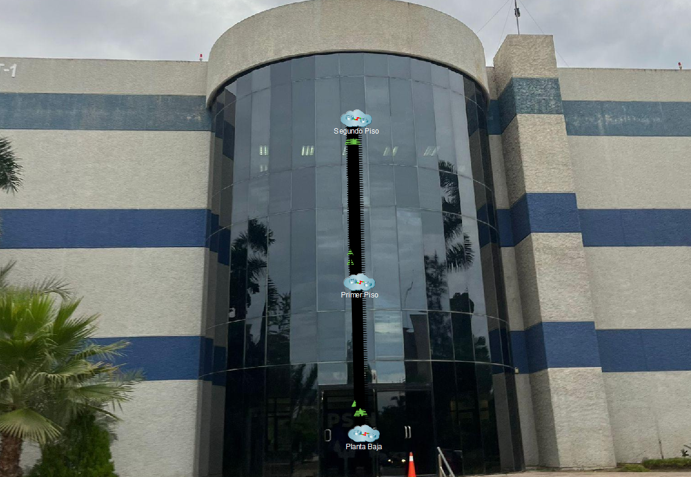

### Logical topology (site)

Core switch, access switches, router, server network, and IoT devices.

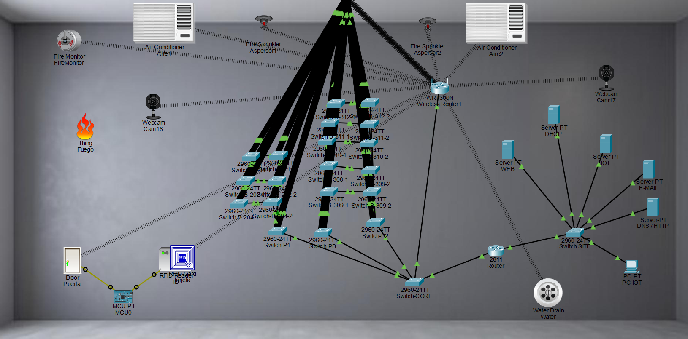

### Floor plans

**Ground floor (Planta Baja)**

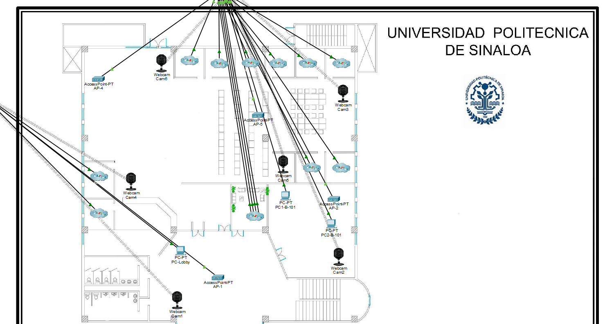

**First floor (Primer Piso)**

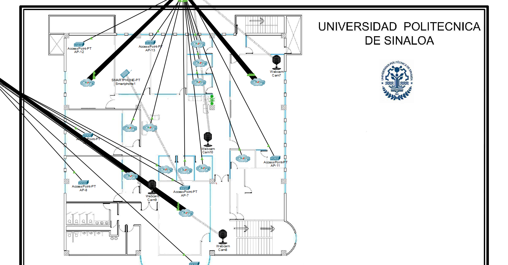

**Second floor (Segundo Piso)**

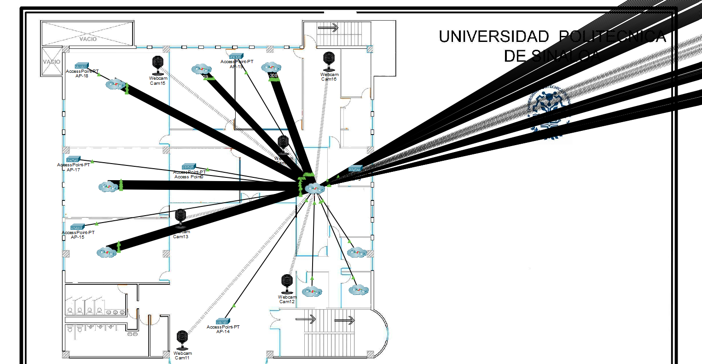

### DHCP

PC11-B-202 (VLAN 20) receiving its IPv4 configuration from the DHCP server.

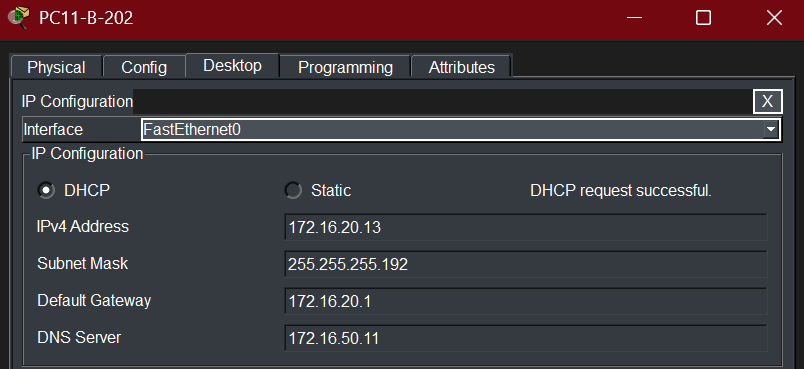

### Inter-VLAN connectivity

PC2-B-309 (VLAN 33) reaching hosts in VLAN 11 and VLAN 20.

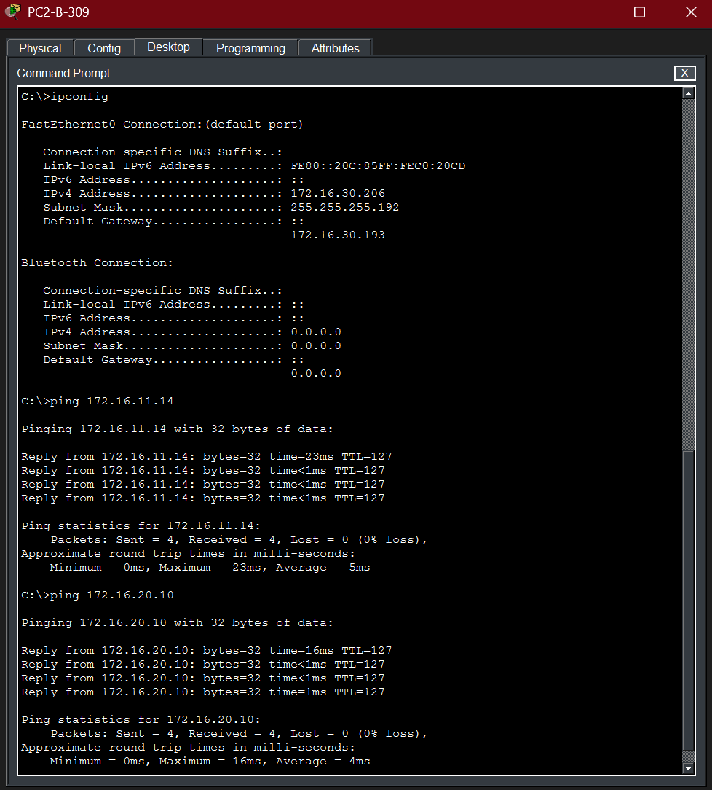

### DNS and website

The university website opened by domain name from PC-B-203.

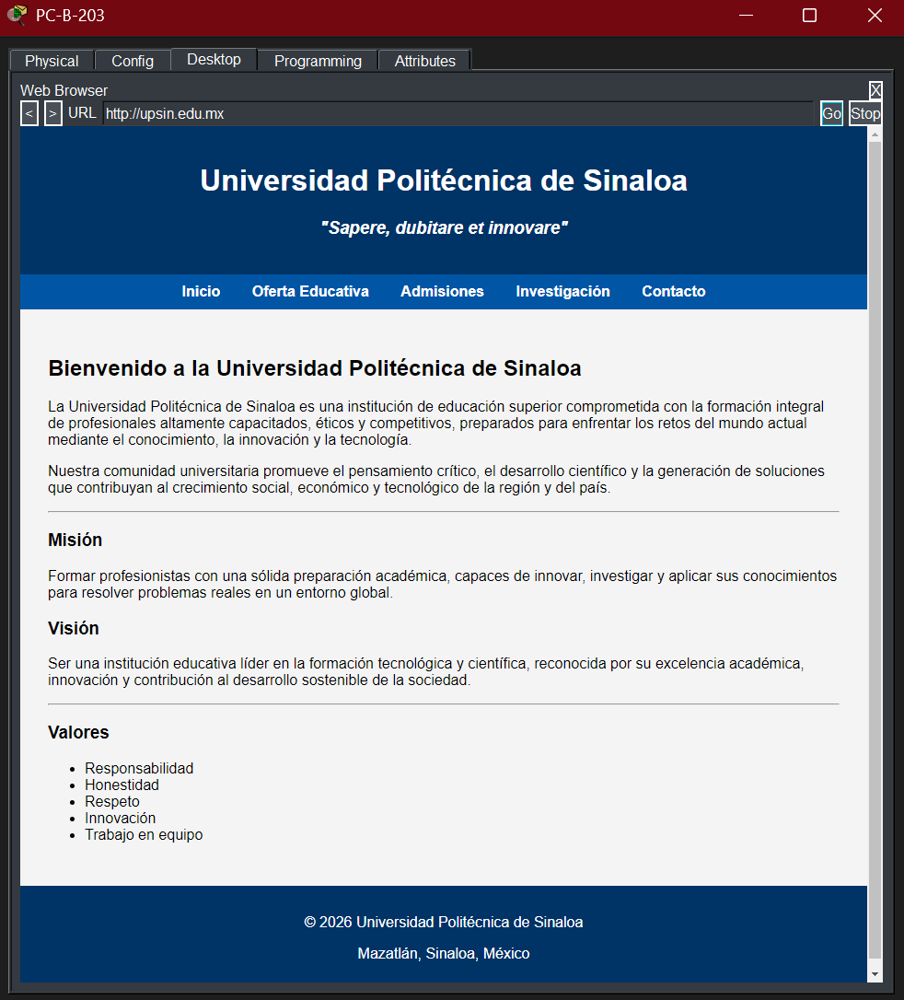

### Email

Email sent by `profesor2` and the reply from `alumno1`, received on two different PCs.

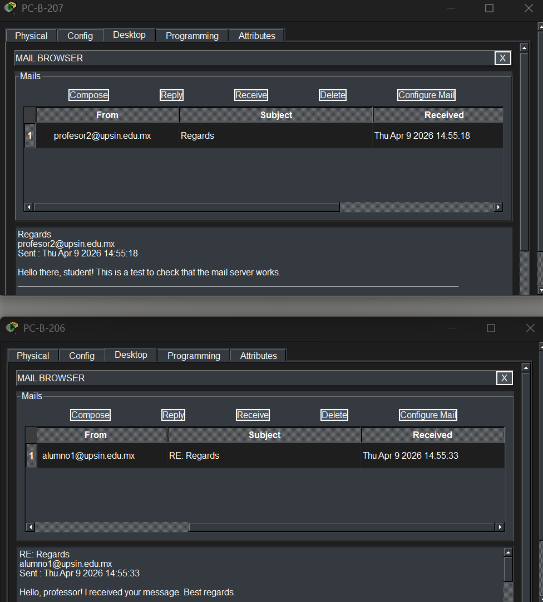

### VoIP call

Active call between extension 1016 and extension 1003.

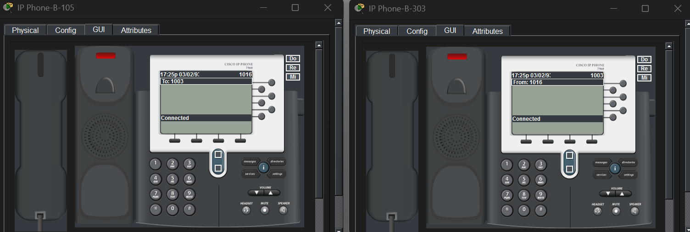

### IoT automation rules

Access control and fire suppression rules configured in IoT Monitor.

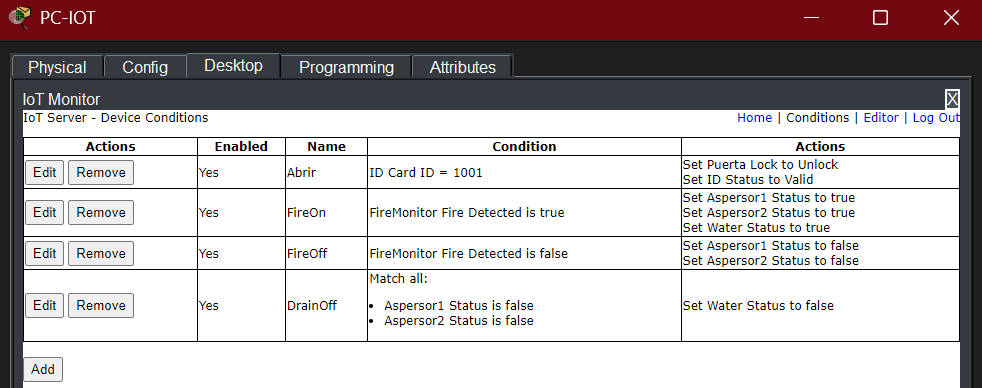

## Technologies and Protocols

- Cisco Packet Tracer
- IPv4 and private addressing
- VLSM and subnetting
- VLANs
- IEEE 802.1Q trunking
- Router-on-a-Stick
- DHCP
- DNS
- HTTP
- SMTP / POP3
- VoIP and Cisco CME
- TFTP
- IoT Monitor
- ICMP

## How to Open the Project

1. Install Cisco Packet Tracer **9.0** or later.
2. Download the file `infraestructura-red-universitaria.pkt` from this repository.
3. Open the file with Cisco Packet Tracer.

Files saved in newer versions of Packet Tracer cannot be opened in older versions.

## Project Status

The network infrastructure and its main services were configured and validated in Cisco Packet Tracer. The project demonstrates a functional segmented network for a university building, including wired and wireless connectivity, centralized services, VoIP, and IoT integration.

## Author

**Jesús Rodríguez Samperio**
Information Technology and Digital Innovation Engineering student, Universidad Politécnica de Sinaloa (UPSIN).

- Portfolio: https://portafolio-jesus-samperio.netlify.app/
- GitHub: https://github.com/jesusamperio
